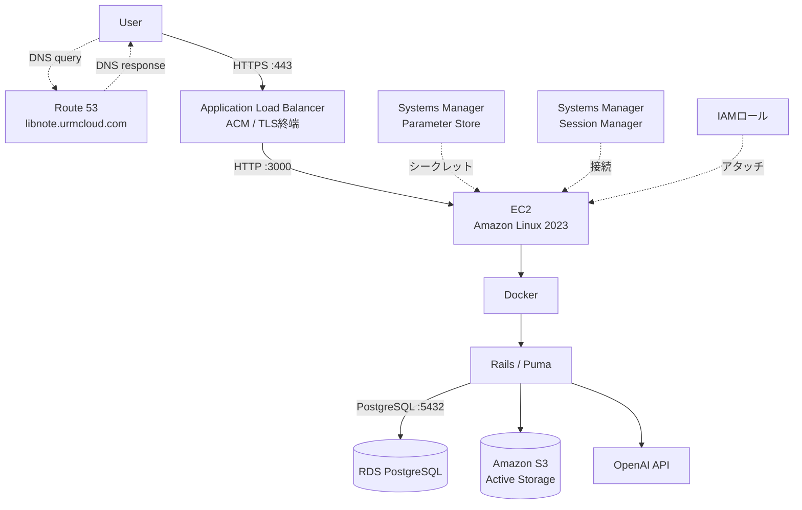
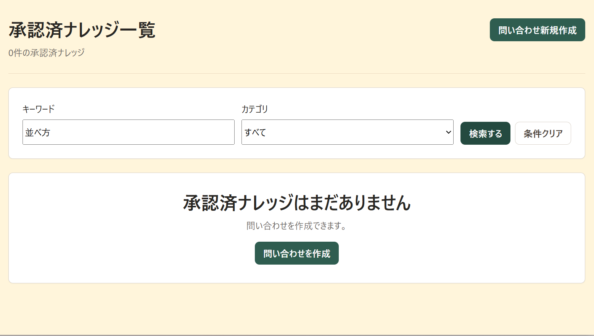
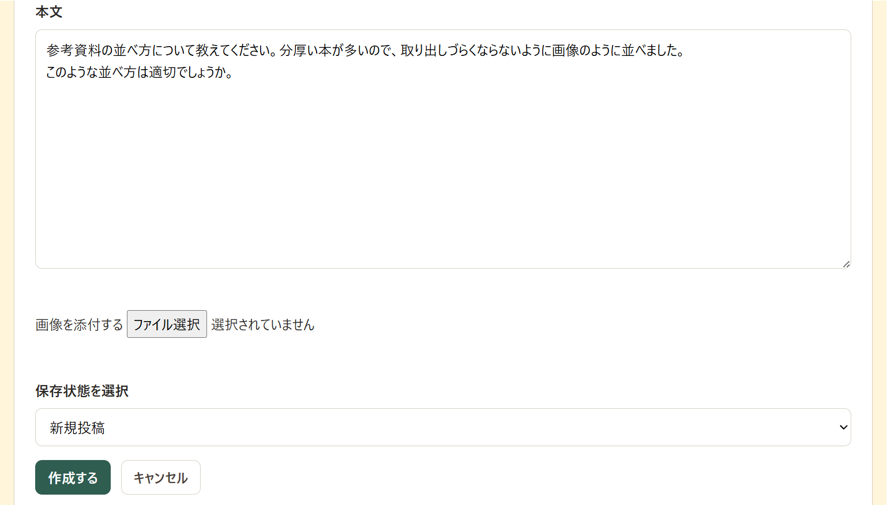
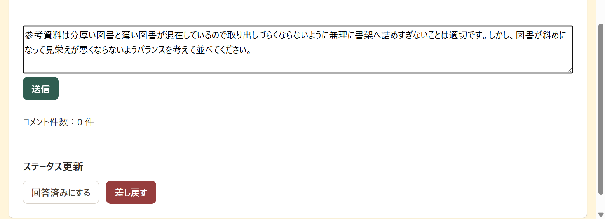
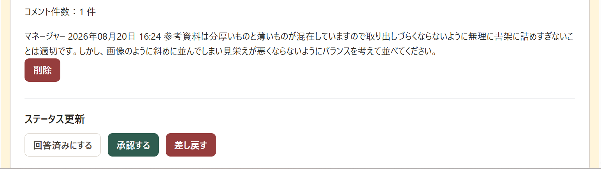
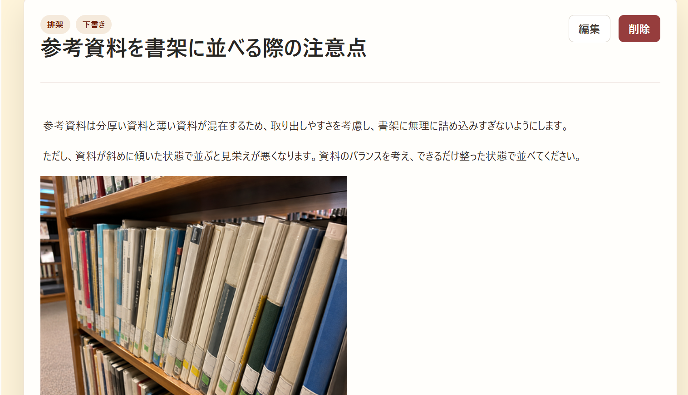
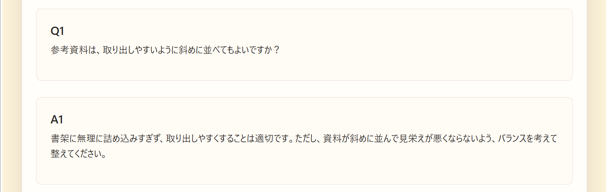
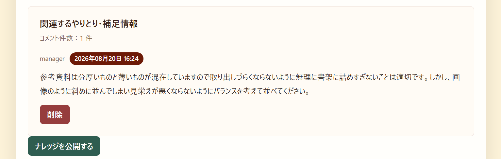
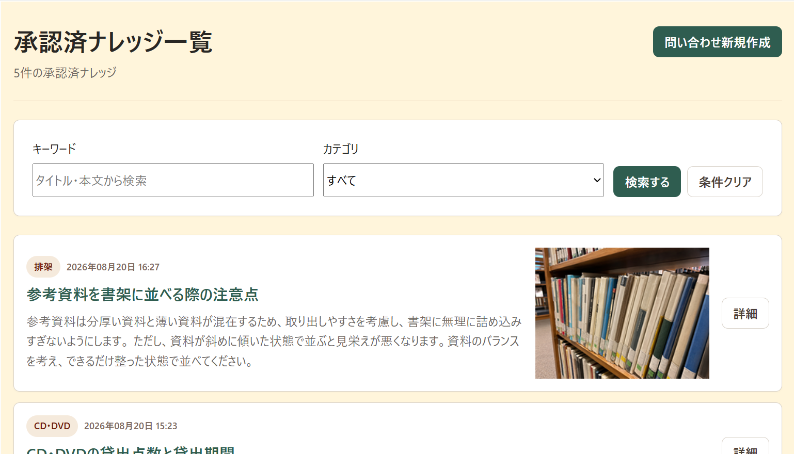

# LibNote（リブノート）

### 図書館スタッフのための業務ナレッジ共有アプリ

## LibNoteとは

LibNoteは、複雑な図書館業務に関するFAQ・対応ノウハウを一元管理し、どんな人でも、必要な情報にすばやくアクセスできるようにする業務支援アプリです。図書館に限らず、拠点を複数持つ現場スタッフの業務知識を標準化するアプリとして活用できます。

## 公開URL

[https://libnote.urmcloud.com](https://libnote.urmcloud.com)

## 制作背景

きっかけは私の業務経験です。
いくつもの分館(拠点)を持つ大規模図書館では、正規職員・委託スタッフ・新人スタッフなど業務経験やITリテラシーが多様な人員体制で均一のサービス品質を求められます。しかしながら実際の現場では、重要な業務情報がスタッフ間で十分に共有されていなかったり、担当者や拠点によって利用者対応にばらつきが生じたりする場面がありました。
また、従来の紙やPDF中心のマニュアルは、年々文量が肥大化し、必要な情報を探しづらくうまく活用されていないという課題がありました。

LibNoteは、こうした現場課題のもとに、業務ナレッジを一元的にわかりやすく整理・共有することを目的として開発したアプリです。

## 問題点

- 中央館と分館との情報格差があり、業務の情報が適切に共有されていない
- 紙やPDFの業務マニュアルは、業務の複雑化に伴って文量が増え、必要な情報が探しにくくなりがちである。表現が堅く、経験の浅いスタッフには理解しづらい場面がある
- 業務上の不明点は結果的に中央館に問い合わせることになり、同じ質問のやりとりが組織全体の業務量を増加させる
- 図書館は基本的に土日祝日問わずサービス提供をしているので研修の機会が少ない


## 解決策

- 業務ナレッジを一元管理し、全拠点から同じ情報にアクセスできるようにする
- カテゴリ・検索・FAQ化により必要な情報を見つけやすくする
- スタッフの問い合わせからFAQやナレッジ記事を作成し、再利用する
- 問い合わせからAIがナレッジとFAQの下書きを作成。内容確認の上、公開することで負担を減らして正しい情報を共有できる
- ナレッジ記事やFAQにより自己学習しやすくする


## 想定ユーザー・役割

分館(拠点)を複数持つ大規模図書館(サービス提供施設)のスタッフを想定しています。


|ロール    | 具体例                       | 役割                         |
| ------ | ------------------------- | -------------------------- |
| スタッフ   | 委託スタッフ・分館スタッフ・窓口職員・新人スタッフ | 業務上の不明点を調べたい               |
| マネージャー | 直営スタッフ・中央館スタッフ・業務担当者      | 業務担当として業務上の不明点を回答          |
| 管理者    | システム担当・承認者                | カテゴリ管理・記事承認・ユーザー管理・AI下書き確認 |


## 主な機能

- ユーザー登録、ログイン、ログアウト
- ユーザーの権限管理
- 問い合わせの投稿、閲覧、編集、削除
- 問い合わせの下書き保存
- 問い合わせへの画像添付
- 問い合わせ画像の個別削除
- コメントによる回答、補足
- 問い合わせのステータス管理
- キーワード、カテゴリ、ステータス検索
- AIによるナレッジ・FAQの下書き作成
- ナレッジの編集、公開、下書きへの変更
- 公開済みナレッジ・FAQの閲覧
- カテゴリ管理
- ユーザー管理
- 管理者向け要対応ダッシュボード

※AIが作成した下書きは自動では公開されず、管理者が確認してから公開するという流れです

---

## AWS構成





HTTPアクセスはApplication Load BalancerでHTTPSへリダイレクトし、ACMで発行したTLS証明書を利用してHTTPS通信を行っています。

---


## AWS構成で意識した点


### アプリケーションとデータの分離

RailsアプリケーションはEC2上のDockerコンテナで実行し、データベースはRDS PostgreSQLへ分離しました。
また、Active Storageで扱う画像はS3へ保存しています。

```text
Application  → EC2 / Docker
Database     → RDS PostgreSQL
Image        → Amazon S3
```
Dockerコンテナを再作成してもDBデータやアップロード画像が失われない構成としています。

---
### IAMロールによるS3アクセス

RailsからS3へアクセスする際は、EC2に付与したIAMロールを利用しています。
AWS SDKがEC2のIAMロールから一時認証情報を取得し、S3 APIを呼び出す構成としました。

---
### 秘密情報の管理

以下のような機密情報はソースコードへ直接記載せず、AWS Systems Manager Parameter StoreのSecureStringとして管理しています。

- Database接続情報
- Rails Master Key
- OpenAI API Key

EC2に付与したIAMロールには、必要なParameterのみ取得できる権限を設定しています。

---
### EC2への管理接続

EC2への管理接続にはSSHを使用せず、AWS Systems Manager Session Managerを利用しています。
そのため、SSH用の22番ポートをインターネットへ公開せずにEC2を管理できる構成としています。

---
### セキュリティグループ

セキュリティグループでは必要な通信元だけを許可しています。

```text
Internet
   ↓ HTTP :80 / HTTPS :443
ALB
   ↓ HTTP :3000
EC2
   ↓ PostgreSQL :5432
RDS
```

EC2の3000番ポートはインターネット全体には公開せず、ALBのセキュリティグループからの通信のみ許可しています。

---
### HTTPS対応

独自ドメインとして以下を使用しています。

```text
libnote.urmcloud.com
```

Route 53でDNSを管理し、Application Load BalancerにACMで発行した証明書を設定しています。

HTTPアクセスはALBでHTTPSへリダイレクトしています。

```text
http://libnote.urmcloud.com
        ↓
Application Load Balancer
        ↓
HTTPSへRedirect
        ↓
https://libnote.urmcloud.com
```

---
### Active Storage

デプロイ環境によってActive Storageの保存先を切り替えられるよう、環境変数から使用するストレージサービスを指定する構成としています。

```ruby
config.active_storage.service =
  ENV.fetch("ACTIVE_STORAGE_SERVICE", "cloudinary").to_sym
```

AWS環境では、

```text
ACTIVE_STORAGE_SERVICE=amazon
```

を設定し、Amazon S3を利用します。
これにより、環境ごとの差異をソースコードへ直接埋め込まず、同一コードを利用できる構成としています。

---
### デプロイ

AWS環境では、GitHubの更新後にEC2上でDocker imageを再buildしてデプロイしています。

```text
GitHubへpush
      ↓
EC2でgit pull
      ↓
docker build
      ↓
旧Containerを停止・削除
      ↓
新しいContainerを起動
```

Dockerコンテナにはrestart policyを設定し、EC2再起動後も自動的にRailsアプリケーションが起動するようにしています。

再デプロイ後も、

- RDS上の既存データ
- S3上の画像
- ログイン
- CRUD
- AI生成

が正常に利用できることを確認しています。

---
### AWSの今後の改善

現在はAWSの基本構成を理解することを優先し、手動でデプロイしています。
今後の改善候補として以下を想定しています。

- Amazon ECRによるDocker image管理
- ECS / Fargateへの移行
- CloudWatchによる監視・ログ管理
- CloudFormationによるInfrastructure as Code

現時点では機能を増やすことよりも、現在の構成を自分で理解・運用できることを重視しています。

---


## LibNote 利用方法


### 1. ユーザー登録・ログイン

初めて利用する場合はユーザー登録を行います。登録済みの場合は、メールアドレスとパスワードでログインします。


### 2. ナレッジやFAQを検索

ナレッジ一覧やFAQ一覧から、知りたい内容を検索します。ナレッジはキーワードやカテゴリで絞り込むことができます。ここでは、必要な情報が見つからなかったため、問い合わせを作成することにします。



### 3. 問い合わせを投稿

タイトル、カテゴリ、本文を入力し、必要であれば画像も添付します。作成途中の内容は下書きとして保存できます。



### 4. 担当者が回答

担当者は問い合わせの内容を確認し、コメントを投稿します。回答や補足を追加し、対応が終わったら「回答済み」にします。



### 5. 問い合わせを承認

管理者が「回答済み」の問い合わせの内容を確認して承認すると、AIがナレッジとFAQの下書きを作成します。AIによる下書きは、管理者が内容を確認・編集したあとに公開します。

管理者が「回答済み」の問い合わせを承認します



AIがナレッジ下書きを作成します



FAQの下書きも作成されます



AIによる下書きを確認、編集の上、ナレッジを公開します



### 6. ナレッジが公開される

ナレッジとFAQが全スタッフに公開されます。



## 使用技術・環境


| 項目          | 内容                                                                                                                                                                                                 |
| ----------- | -------------------------------------------------------------------------------------------------------------------------------------------------------------------------------------------------- |
| OS          | Windows                                                                                                                                                                                            |
| 言語          | Ruby 3.2.9                                                                                                                                                                                         |
| フレームワーク     | Ruby on Rails 7.1.6                                                                                                                                                                                |
| データベース      | 開発環境：SQLite 本番環境：Amazon RDS for PostgreSQL                                                                                                                                                                        |
| フロントエンド     | HTML / SCSS / JavaScript                                                                                                                                                                           |
| CSSフレームワーク  | Bootstrap 5                                                                                                                                                                                        |
| 認証          | Devise                                                                                                                                                                                             |
| 権限管理        | Pundit                                                                                                                                                                                             |
| 画像管理        | Active Storage / Amazon S3                                                                                                                                                                                     |
| AI          | OpenAI API                                                                                                                                                                                         |
| バージョン管理     | Git / GitHub                                                                                                                                                                                       |
| インフラ環境（AWS） | AWS EC2 / Amazon RDS for PostgreSQL/Amazon S3 / Application Load Balancer / Amazon Route 53 / AWS Certificate Manager / AWS Systems Manager / Session Manager / Parameter Store / AWS IAM / Docker |


